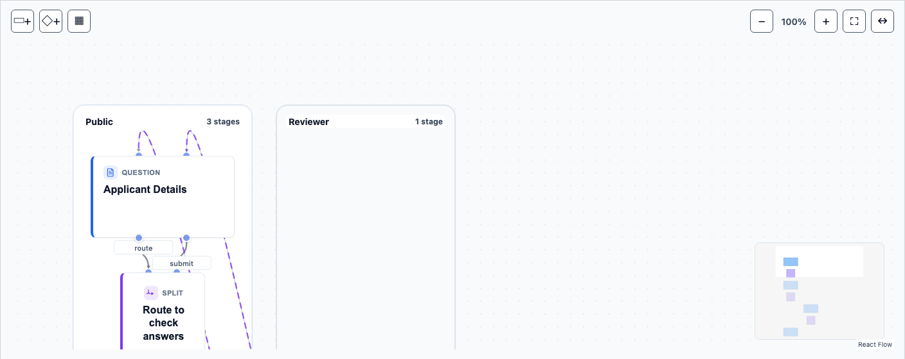
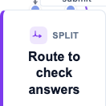
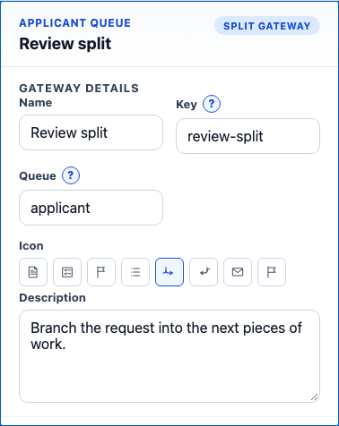
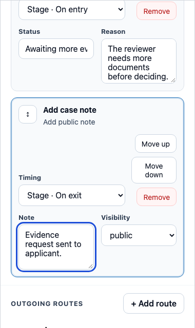
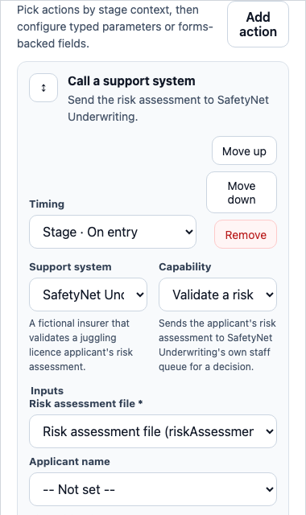
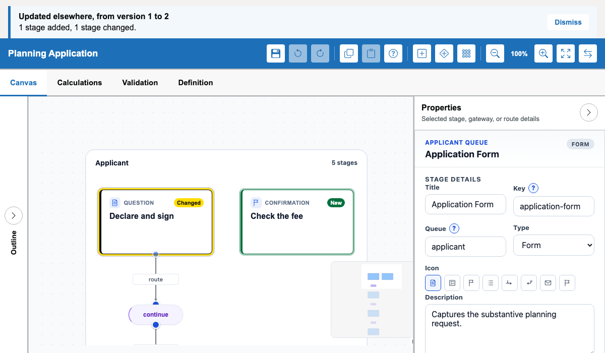
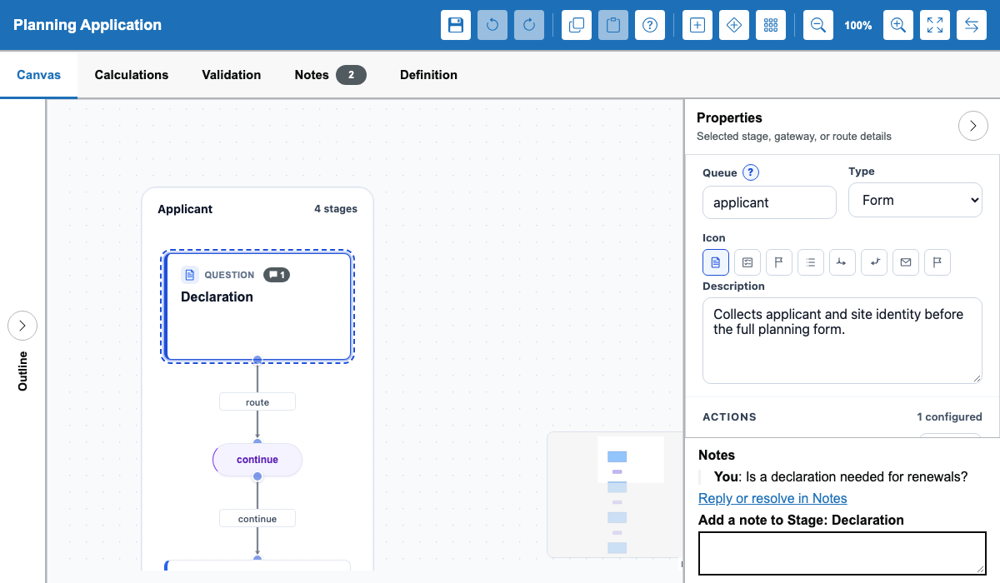
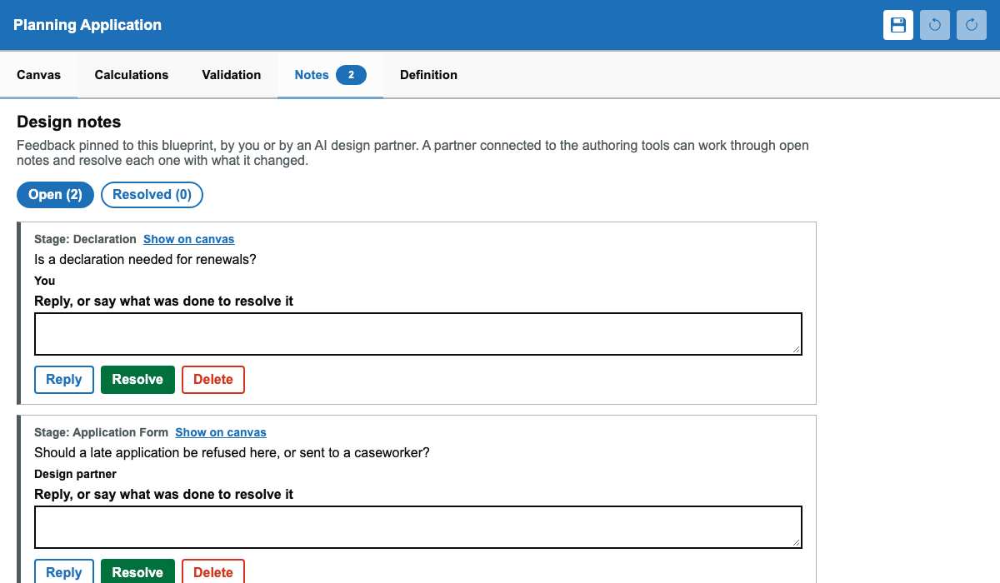

# The Canvas tab

## Overview

The Canvas tab is the primary editing surface, where the editor opens by default, and
where the toolbar (Save/Undo/Redo, per every other tab's own doc in this series) actually
lives. It has two parts: the **graph** itself (a React Flow canvas rendering `queues` as
lane columns, `stages` and `gateways` as nodes, and `routes` as edges between them, see
[`docs/guides/reference-service-blueprint-contract.md`](../../guides/reference-service-blueprint-contract.md)
for what those actually are in the model), and the **properties panel**
(`<wayfinder-step-inspector>`) that opens alongside it when a stage, gateway, or component
is selected.

## Walkthrough

### The graph: lanes, stages, routes

Each queue is its own lane column; a stage shows its shell kind (Question, CheckAnswers,
…) and name; routes between nodes carry their trigger label:



### Gateways

A Split routes to more than one place, a Join merges routes back together, both render as
a distinct node kind on the graph, separate from a stage, with their own icon and label:



*(A single-route Split specifically renders as a compact pill rather than this fuller
card, not pictured here, since neither fixture used for this doc's screenshots happens to
contain one; see `[data-wayfinder-gateway-shape]` below.)*

### The properties panel

Selecting anything opens `<wayfinder-step-inspector>` alongside the graph. For a gateway,
that's its name/key/queue/icon/description plus its routing summary:



For a stage, the same panel edits its actions, pick an action type, fill in its real
parameters (forms-backed fields validate as you go), reorder or remove:



A `support-system-call` action, calling out to a registered support system (NN/g's third
service-blueprint lane; see [`docs/guides/support-systems.md`](../../guides/support-systems.md)),
gets its own dedicated editor instead of the generic parameter form above: cascading
support-system → capability pickers, then one field per the chosen capability's own declared
inputs (reusing the same reference-aware field-ref dropdowns the properties panel's own component
editing uses), plus a hint naming the outcomes the carrying stage's own outgoing routes should
trigger on:



Some property fields are **reference-aware** rather than free text, `conditionalOn`
offers a dropdown of the current stage's own sibling field keys, `defaultFrom` offers the
blueprint's declared calculation field names, `changeStateKey` offers real stage keys,
removing an entire class of typo-driven dangling-reference errors at the source. (Not
pictured in this doc's own screenshots, see
[`docs/skills/calculations-editor/SKILL.md`](../calculations-editor/SKILL.md) for
`defaultFrom` specifically, since it reads from the same calculation field list that tab
authors.)

### Changes saved elsewhere

When an AI design partner, or another person, saves the blueprint while you have it open, the
canvas moves to their version within a few seconds, as long as you have nothing unsaved. Your zoom,
position and selection stay where they were. A notice above the toolbar says which versions it moved
between and what changed, and the canvas marks each stage and gateway that is **New** or
**Changed**, and draws changed routes in green. Several saves in a row add up into one summary until
you choose **Dismiss**.



If you do have unsaved changes, the editor keeps them and goes read-only instead, with a banner
explaining that the blueprint changed elsewhere. Copy anything you want to keep, then reload the
latest version.

### Design notes

A design note is feedback pinned to part of the blueprint, for an AI design partner to work
through, or a question the partner pins back for you. Select a stage, a gateway or a route and
write in **Add a note** at the bottom of the Properties panel; with nothing selected, the note is
about the whole blueprint. A stage or gateway with open notes shows a note marker with the count.



The **Notes** tab lists every note, open or resolved, with what it is pinned to and a link to show
it on the canvas. Reply to a note, or resolve it by saying what was done. A design partner
connected to the authoring tools can read the open notes, change the blueprint, and resolve each
one with what it changed and the version it changed it in; the notes update within a few seconds,
without a reload. Reopen a resolved note if the change didn't do it, and its resolution stays in
the replies.



Notes are not part of the blueprint: adding or resolving one never needs a save. If a stage with
notes is deleted, its notes stay, at the level of the whole blueprint.

## For agents

- The graph custom element: `<wayfinder-service-blueprint-graph>`, ready once it carries
  `data-wayfinder-graph-ready="true"` (an empty blueprint renders `[data-wayfinder-empty-state]`
  instead and never sets this).
- A lane: `[data-wayfinder-role-queue]` / `[data-wayfinder-queue-container]`. A stage node:
  `[data-wayfinder-stage="<key>"]` (also `[data-wayfinder-stage-card]` on its outer shell).
  A gateway node: `[data-wayfinder-gateway="<key>"]` (outer shell
  `[data-wayfinder-gateway-node]`), with `data-wayfinder-gateway-kind="Split"|"Join"` and
  `data-wayfinder-gateway-shape="pill"|"diamond"` (a pill only for a single-route Split;
  everything else, including every Join, is the fuller `"diamond"` form). A route edge:
  `[data-wayfinder-route-path]` (`data-wayfinder-route-from`/`-to` name the endpoints);
  `[data-wayfinder-transition]` for the transition/route label itself.
- Select something with a click, or focus + `Enter` for keyboard-only selection; a
  selected gateway/stage gets `aria-pressed="true"`.
- The properties panel: `<wayfinder-step-inspector>`, with
  `[data-wayfinder-inspector-kind]="stage"|"gateway"|"component"` and
  `[data-wayfinder-inspector-heading]` for what's currently selected.
  `[data-wayfinder-field="<name>"]` for a gateway's own read-only summary fields. For stage
  actions specifically: `[data-wayfinder-open-action-picker]` +
  `[data-wayfinder-action-picker-option="<action-type>"]` +
  `[data-wayfinder-action-picker-add]` to add one, `[data-wayfinder-action-param="<index>-<paramName>"]`
  for each parameter, `[data-wayfinder-stage-action="<index>"]` per configured action. A
  `support-system-call` action's own dedicated editor instead:
  `[data-wayfinder-support-system-select="<index>"]` /
  `[data-wayfinder-support-system-capability-select="<index>"]` for the cascading pickers, each
  input rendered at id `support-system-call-<index>-<inputKey>` (e.g.
  `#support-system-call-0-File`), `[data-wayfinder-action-errors="<index>"]` for its own
  validation messages.
- Changes saved elsewhere: `[data-wayfinder-recent-changes]` is the notice, with
  `[data-wayfinder-dismiss-recent-changes]` to clear it, and `[data-wayfinder-recent-changes-status]`
  the live region that announces each update. A highlighted node carries
  `data-wayfinder-stage-change` or `data-wayfinder-gateway-change` (`"added"` or `"changed"`); a
  highlighted route carries `data-wayfinder-route-recently-changed="true"`. With unsaved work the
  editor shows `[data-wayfinder-stale-service-blueprint-overlay]` instead.
- Design notes: `[data-wayfinder-add-design-note]` is the add-a-note form under the Properties
  panel, and `[data-wayfinder-selection-notes]` the section around it. A node with open notes
  carries `data-wayfinder-stage-notes` or `data-wayfinder-gateway-notes` (the count). In the Notes
  tab (`[data-wayfinder-confidence-tab="notes"]`, badge `[data-wayfinder-tab-badge="notes"]`),
  each note is `[data-wayfinder-design-note="<id>"]` with `data-wayfinder-design-note-status`
  (`"Open"` or `"Resolved"`), and a resolution is `[data-wayfinder-design-note-resolution]`.
- The toolbar (Save/Undo/Redo) lives inside this tab's own slotted content, hidden while
  any other tab is active. Every other tab's own doc in this series notes this same thing;
  it's this tab you have to be on to actually click Save.

## Keeping this current

Every screenshot above is written by one of five Storybook-driven specs in
`Wayfinder.Editor.Client/tests/service-blueprint-editor/`:
`service-blueprint-graph-visual.spec.ts` (graph overview, gateway shape),
`service-blueprint-editor-gateways.spec.ts` (gateway inspector),
`stage-action-editor.spec.ts` (stage action editor),
`support-system-action-editor.spec.ts` (support-system-call action editor), and
`service-blueprint-editor-follow-changes.spec.ts` (changes saved elsewhere). Regenerate with:

```
cd Wayfinder.Editor.Client && CAPTURE_DOC_SCREENSHOTS=1 npx playwright test service-blueprint-graph-visual.spec.ts service-blueprint-editor-gateways.spec.ts stage-action-editor.spec.ts support-system-action-editor.spec.ts service-blueprint-editor-follow-changes.spec.ts
```
